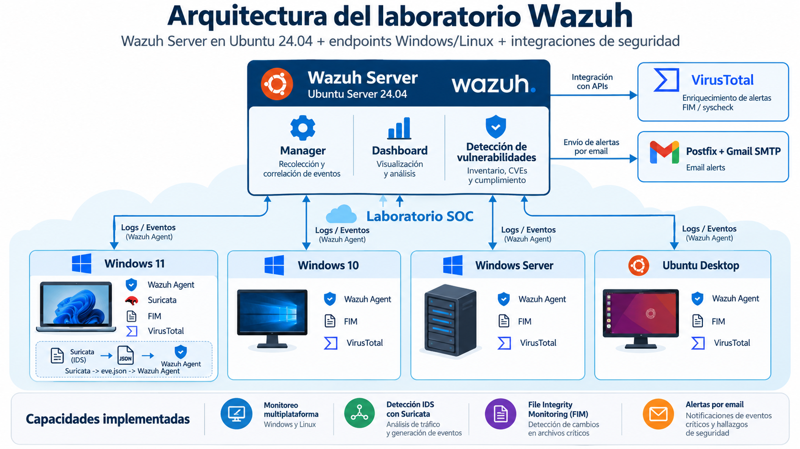

# Wazuh SOC Lab

**Security Monitoring, Threat Detection & Integrations**

**Laboratorio SOC con Wazuh | Monitoreo de seguridad, detección de amenazas e integraciones**

---

Diseño e implementación de un laboratorio de monitoreo de ciberseguridad utilizando Wazuh SIEM/XDR sobre Ubuntu Server 24.04, con endpoints Windows y Linux, integración de Suricata IDS, monitoreo de integridad de archivos (FIM), enriquecimiento de eventos mediante VirusTotal, detección de vulnerabilidades y alertas automáticas por correo electrónico mediante Postfix y Gmail SMTP.
  

## Objetivos del proyecto

### Objetivo general

Diseñar, implementar y validar un laboratorio SOC basado en Wazuh SIEM/XDR, orientado a centralizar eventos de seguridad de sistemas Windows y Linux, integrar herramientas de detección y enriquecer la información recopilada para facilitar el monitoreo, análisis y gestión de amenazas.

### Objetivos específicos

1. Implementar Wazuh sobre Ubuntu Server 24.04 para centralizar la recopilación y análisis de eventos.
2. Desplegar agentes Wazuh en Windows 11, Windows 10, Windows Server 2022 y Ubuntu Desktop.
3. Integrar Suricata IDS en Windows 11 para recopilar y visualizar eventos relacionados con el tráfico de red.
4. Configurar FIM, VirusTotal y Vulnerability Detection para monitorear cambios en archivos, enriquecer alertas e identificar vulnerabilidades.
5. Implementar notificaciones automáticas mediante Postfix y Gmail SMTP para comunicar eventos de seguridad.
  

## Arquitectura del laboratorio

El laboratorio SOC utiliza una arquitectura centralizada para la recopilación, monitoreo y análisis de eventos de seguridad provenientes de sistemas Windows y Linux, mediante Wazuh SIEM/XDR.

La infraestructura está compuesta por un servidor principal con Ubuntu Server 24.04 y cuatro endpoints independientes monitoreados mediante Wazuh Agent v4.14.7.

### Diagrama de arquitectura

### Componentes de infraestructura

| Equipo | Sistema operativo | Función |
|---|---|---|
| Wazuh Server | Ubuntu Server 24.04 | Gestión y análisis centralizado de eventos de seguridad |
| AgentW11 | Windows 11 | Wazuh Agent, Suricata IDS y FIM |
| AgentW10 | Windows 10 | Wazuh Agent y FIM |
| Win_Server2022 | Windows Server 2022 | Wazuh Agent y FIM |
| Server_Linux | Ubuntu Desktop | Wazuh Agent y FIM |

### Integraciones de seguridad

**Suricata IDS:** implementado sobre Windows 11 para inspeccionar tráfico de red y generar eventos de seguridad en formato JSON mediante `eve.json`, posteriormente recopilados por Wazuh Agent y enviados al servidor central.

**File Integrity Monitoring (FIM):** habilitado en los endpoints monitoreados para identificar modificaciones, creaciones y eliminaciones de archivos en los directorios configurados.

**VirusTotal:** integrado con Wazuh Manager mediante API para consultar la reputación de archivos y enriquecer las alertas FIM configuradas.

**Vulnerability Detection:** funcionalidad utilizada para identificar vulnerabilidades conocidas en los sistemas operativos y paquetes de software monitoreados.

**Email Alerts:** integración de Wazuh con Postfix y Gmail SMTP para enviar notificaciones automáticas sobre eventos de seguridad.

## Documentación técnica

Esta sección contiene los procedimientos técnicos utilizados durante la implementación del laboratorio SOC con Wazuh. Cada documento incluye los pasos de configuración, comandos y referencias correspondientes a las herramientas integradas.

| N.º | Procedimiento | Descripción |
|---|---|---|
| 01 | [Instalación de Wazuh Server](docs/01-instalacion-wazuh.md) | Instalación All-in-One, administración LVM y configuración documentada de Vulnerability Detection. |
| 02 | [Suricata IDS + Wazuh Agent](docs/02-suricata-windows11.md) | Implementación de Suricata en Windows 11, recopilación de eventos JSON y monitoreo mediante Wazuh. |
| 03 | [FIM + VirusTotal](docs/03-fim-virustotal.md) | Monitoreo de integridad de archivos, integración mediante API y pruebas de funcionamiento. |
| 04 | [Email Alerts — Postfix + Gmail SMTP](docs/04-email-alerts.md) | Configuración de notificaciones automáticas de seguridad mediante correo electrónico. |
  

Los procedimientos de instalación, configuración y validación de las integraciones implementadas se encuentran documentados en archivos técnicos independientes, disponibles en la sección de documentación técnica de este repositorio.
  

## Evidencias de implementacion

El laboratorio cuenta con nueve evidencias visuales que documentan el funcionamiento de Wazuh, el monitoreo de endpoints Windows/Linux y las integraciones de Suricata IDS, FIM, VirusTotal, Email Alerts y Vulnerability Detection.

Las capturas corresponden a pruebas realizadas en el entorno de laboratorio y permiten observar los resultados obtenidos durante la implementación.

📂 **[Consultar las nueve evidencias del laboratorio](evidence/README.md)**
  
